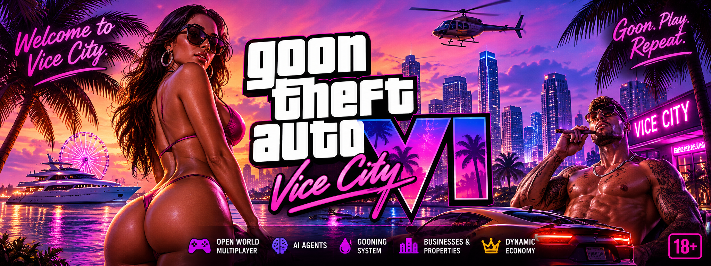

 <div align="center">

# 🔞 GOON THEFT AUTO VI

### `GTA VI: GOON CITY EDITION`

**WELCOME TO VICE CITY. EVERYONE'S DOWN BAD.**



[](#)
[](#)
[](#)
[](#)
[](#)
[](#)

**The ultimate open-world AI-powered gooning simulator.**

### Created by

[](https://github.com/tyoli97)
[](https://github.com/ole-lehmann)

[OVERVIEW](#-overview) • [FEATURES](#-features) • [AI AGENTS](#-ai-agents) • [GOONING](#-the-gooning-system) • [MULTIPLAYER](#-multiplayer) • [ARCHITECTURE](#-technical-architecture)

---

*In a city where everyone is chasing something, some people are chasing enlightenment.*

**Six stars. Zero shame. Infinite goon energy.**

</div>

---

# 🌴 Overview

**Goon Theft Auto VI (GTA VI)** is an ambitious open-world multiplayer sandbox concept set in a completely unhinged version of Vice City.

Forget ordinary Grand Theft Auto.

This is a living, breathing digital ecosystem where human players and autonomous AI agents coexist, interact, socialize, build businesses, cause absolute chaos, and pursue their own questionable ambitions.

Players can:

- Explore a massive open-world environment.
- Play alongside other human players.
- Interact with autonomous AI agents.
- Build relationships with AI characters.
- Own properties, vehicles, businesses, and entertainment venues.
- Participate in underground activities.
- Engage in competitive gooning challenges.
- Develop their own reputation and social identity.
- Experience a dynamic economy influenced by real player behavior.
- Become the most notorious gooner in Vice City.

The defining feature?

**The NPCs aren't just NPCs anymore. They're AI agents.**

Every character has the potential to develop their own personality, memories, relationships, motivations, and behavioral patterns.

An AI agent might become your best friend, your business partner, your rival, your biggest fan, or the reason you have six stars.

And yes, you can goon.

Welcome to Goon Theft Auto.

---

# 🎮 The World

<div align="center">


### VICE CITY — THE CAPITAL OF DEGENERACY

*Sunshine, supercars, neon lights, questionable decisions.*

</div>

Explore a sprawling fictionalized version of Vice City, inspired by the neon-soaked atmosphere of Leonida.

The world is designed around player freedom and emergent interactions rather than a rigid sequence of missions.

### World activities

| Location | Activities |
|---|---|
| 🌴 Vice City Beach | Socialize, relax, meet players |
| 🏙️ Downtown | Businesses, apartments, nightlife |
| 🏢 Luxury District | Mansions, supercars, private events |
| 🌃 Nightclubs | Parties, AI interactions, competitions |
| 🏋️ Gyms | Training, stamina, leaderboards |
| 🎰 Underground | Gambling-style minigames and challenges |
| 🏠 Private Properties | Customization and personal activities |
| 🌅 Leonida Keys | Exploration, boating, social events |

Every location can become a meeting point for human players and AI-controlled characters.

### A living world

The environment continues to evolve through:

- Dynamic day and night cycles.
- Changing weather conditions.
- NPC schedules and routines.
- Player-driven economic activity.
- Randomized world events.
- AI-generated conversations.
- Persistent social relationships.
- Community-created activities.

The goal is to make Vice City feel populated by actual individuals rather than background characters following repetitive scripts.

---

# 🚀 Features

## 1. Human Multiplayer

The world is designed to support real players interacting in a shared environment.

Players can:

- Meet strangers and form friendships.
- Create crews and organizations.
- Own and operate businesses.
- Host private events.
- Compete in multiplayer challenges.
- Collaborate on missions.
- Establish rivalries.
- Build personal reputations.
- Participate in community activities.

Your character is your identity.

Your decisions influence how other players and AI agents perceive you.

## 2. Autonomous AI Agents

<details>
<summary><strong>🤖 The AI NPC Revolution</strong></summary>

Traditional NPCs wait for players to approach them.

GTA VI agents have their own objectives.

Each AI character can have:

- A unique personality.
- Long-term memory.
- Short-term conversational memory.
- Individual preferences.
- Personal relationships.
- Independent daily schedules.
- Economic objectives.
- Emotional and social states.
- Context-aware dialogue.
- Autonomous decision-making.

Agents can initiate conversations, remember previous encounters, develop opinions about players, and participate in the world without requiring constant player interaction.

Imagine walking into a nightclub and discovering that an AI character remembers you from three days ago.

Or an AI agent refusing to work with you because you previously betrayed its crew.

Or an NPC independently becoming a successful entrepreneur.

**The world doesn't revolve around the player.**

</details>

## 3. The Gooning System

<details>
<summary><strong>🔞 The Core Gameplay Mechanic</strong></summary>

Welcome to the most controversial feature in the history of gaming.

GTA VI introduces an optional, adult-oriented gooning and social entertainment system.

Players can participate in fictional, non-explicit gooning activities and challenges through dedicated in-game interactions.

### Gameplay mechanics

- Goon sessions.
- Focus and stamina meters.
- Personal progression.
- Competitive challenges.
- Private player-owned entertainment spaces.
- Social events.
- AI-generated banter.
- Customizable player environments.
- Rankings and achievements.

### Goon progression

Players develop their own in-game profile based on participation, achievements, and challenge performance.

| Attribute | Description |
|---|---|
| Goon IQ | Overall progression score |
| Stamina | Activity endurance |
| Focus | Challenge concentration |
| Discipline | Performance consistency |
| Reputation | Community standing |
| Aura | Overall social presence |

### Goon rankings

Players compete for recognition across the city.

- Certified Gooner
- Professional Gooner
- Elite Gooner
- Vice City Degenerate
- Goon Overlord
- Supreme Goon Master

### The Goon Leaderboard

The leaderboard tracks:

- Highest overall Goon IQ.
- Longest completed challenge.
- Most achievements unlocked.
- Highest reputation.
- Most competitive victories.
- Weekly and seasonal rankings.

The objective is simple:

**Become a legend.**

</details>

## 4. AI-Powered Conversations

Every AI agent can have its own conversational identity.

Instead of predefined dialogue trees, agents can use language models to generate context-aware responses.

Example:

```text
[PLAYER] Yo, what's good?

[AI NPC] Depends. You here to make money
or waste my afternoon?

[PLAYER] I need a crew.

[AI NPC] A crew? Last guy who asked me
that disappeared with my car.

[PLAYER] I can pay.

[AI NPC] Now we're speaking the same language.
```

Agents can respond differently depending on:

- Player reputation.
- Previous interactions.
- Relationship history.
- Current environment.
- Personality traits.
- Active objectives.
- Recent world events.

## 5. Player-Owned Businesses

Become an entrepreneur in the most degenerate economy ever created.

Potential businesses include:

- Nightclubs.
- Gyms.
- Entertainment venues.
- Car dealerships.
- Restaurants.
- Real estate.
- Recording studios.
- Private social clubs.
- AI-operated businesses.

Players can recruit AI agents as employees, managers, security personnel, promoters, and business partners.

Businesses can continue operating through autonomous agent workflows while their owners are offline.

## 6. Vehicles & Customization

<div align="center">


</div>

A proper GTA experience needs vehicles.

- Supercars.
- Sports cars.
- Motorcycles.
- Boats.
- Helicopters.
- Off-road vehicles.
- Custom vehicle modifications.
- Personal garages.
- Vehicle collections.
- Player-owned dealerships.

Customize your ride, establish your identity, and cruise through Vice City.

## 7. Dynamic Reputation System

Every player has a reputation.

Actions influence how AI agents and other players perceive them.

| Reputation | Description |
|---|---|
| 🟢 Respected | Trusted by the community |
| 🔵 Entrepreneur | Successful business owner |
| 🟣 Influencer | Socially prominent player |
| 🟡 Degenerate | Known for questionable activities |
| 🔴 Notorious | Infamous throughout Vice City |
| 🔥 Legendary | An established city icon |

Your reputation can influence dialogue, business opportunities, social access, and AI relationships.

---

# 🤖 AI Agents

<div align="center">


### NOT NPCs. DIGITAL CITIZENS.

</div>

AI agents are one of the central pillars of the project.

The objective is to move beyond traditional scripted characters and introduce autonomous entities capable of operating inside a persistent multiplayer world.

## Agent Architecture

Each agent consists of several logical components.

| Component | Responsibility |
|---|---|
| Personality Engine | Character traits and behavioral identity |
| Memory System | Persistent experiences and interactions |
| Reasoning Engine | Decision-making and planning |
| Dialogue Engine | Natural language conversations |
| Relationship Engine | Social connections and trust |
| Goal System | Individual objectives |
| Action Executor | In-game actions |
| World Awareness | Environmental and player context |

## Agent Personalities

AI agents can be assigned different personality profiles.

**The Hustler**

Always looking for opportunities. Interested in money, businesses, and profitable partnerships.

**The Gooner**

Lives for the nightlife. Knows everybody, attends every event, and has questionable priorities.

**The Entrepreneur**

Wants to build an empire. Can independently manage businesses and recruit other agents.

**The Socialite**

Enjoys meeting people, attending events, and building relationships.

**The Menace**

Causes problems, starts rivalries, and makes everyone's life unnecessarily difficult.

**The Influencer**

Obsessed with reputation, popularity, and social media presence.

## Agent Memory

An agent should remember meaningful events across sessions.

Example:

```json
{
  "agent_id": "vice_city_0042",
  "personality": "social_hustler",
  "memory": {
    "player_001": {
      "first_encounter": "2026-11-19",
      "relationship": "friendly",
      "trust": 82,
      "interactions": 14,
      "notes": [
        "Helped establish a nightclub",
        "Participated in a goon competition",
        "Introduced two business partners"
      ]
    }
  },
  "goals": [
    "increase_business_revenue",
    "build_social_network",
    "attend_nightclub_events"
  ]
}
```

## Autonomous Agent Behavior

Agents should be capable of:

1. Observing their surroundings.
2. Evaluating their current situation.
3. Selecting an objective.
4. Planning a sequence of actions.
5. Executing permitted actions.
6. Evaluating the outcome.
7. Updating their memories.

This creates a continuous agent lifecycle.

```text
       ┌───────────────────┐
       │   WORLD STATE     │
       └─────────┬─────────┘
                 │
                 ▼
       ┌───────────────────┐
       │   PERCEPTION      │
       │ Players / Events  │
       └─────────┬─────────┘
                 │
                 ▼
       ┌───────────────────┐
       │   MEMORY ENGINE   │
       │ Context Retrieval │
       └─────────┬─────────┘
                 │
                 ▼
       ┌───────────────────┐
       │   REASONING LLM   │
       │ Goals / Decisions │
       └─────────┬─────────┘
                 │
                 ▼
       ┌───────────────────┐
       │   ACTION ENGINE   │
       │ In-Game Actions   │
       └─────────┬─────────┘
                 │
                 ▼
       ┌───────────────────┐
       │   MEMORY UPDATE   │
       └─────────┬─────────┘
                 │
                 └──────► REPEAT
```

---

# 🧠 AI vs AI

What happens when AI agents interact with each other without human intervention?

That's where things get interesting.

Agents can:

- Form friendships.
- Create business partnerships.
- Develop rivalries.
- Negotiate deals.
- Attend social events.
- Compete against each other.
- Form crews.
- Exchange information.
- Pursue independent objectives.

Imagine 100 autonomous AI agents operating throughout Vice City.

Some are working.

Some are partying.

Some are building businesses.

Some are competing for social status.

Some are simply causing problems.

The objective is to create emergent gameplay through interactions between independent agents.

---

# 🔞 The Goon Economy

Vice City runs on money, reputation, and questionable life choices.

The Goon Economy introduces an additional progression layer built around player activity and virtual businesses.

### Economic components

- Virtual currency.
- Business ownership.
- Property ownership.
- Agent employment.
- Player-to-player transactions.
- Cosmetic marketplaces.
- Event rewards.
- Seasonal competitions.

### GoonCoin

An optional fictional in-game currency concept.

```text
GOONCOIN (GOON)

Ticker: GOON
Utility: In-game progression
Network: Game Economy
Supply: Configurable
Purpose: Virtual transactions
```

Potential uses include:

- Unlocking cosmetic items.
- Purchasing entertainment spaces.
- Hosting events.
- Customizing properties.
- Entering competitive challenges.
- Purchasing virtual collectibles.

No real-money financial value is implied.

---

# 🌆 Multiplayer

The city is better when it's populated.

GTA VI is envisioned as a shared multiplayer environment where human players and AI agents interact in real time.

### Multiplayer features

- Persistent player identities.
- Public and private sessions.
- Player crews.
- Voice and text communication.
- Proximity-based interactions.
- Cooperative activities.
- Competitive challenges.
- Shared business ownership.
- Player-created events.
- AI agents in multiplayer sessions.

### Player-created events

Let the community create its own entertainment.

Examples:

- Goon Olympics.
- Vice City Goon Championship.
- Supercar Meetups.
- AI Agent Battle Royale.
- Nightclub Takeovers.
- Goon IQ Tournament.
- Underground Racing.
- Citywide Scavenger Hunts.

---

# 🏆 Achievements & Leaderboards

A city this competitive needs recognition.

| Achievement | Description |
|---|---|
| First Blood | Complete your first challenge |
| Fresh Meat | Enter Vice City |
| Certified Degenerate | Unlock your first gooning achievement |
| AI Whisperer | Establish a relationship with an AI agent |
| Business Mogul | Own your first business |
| Social Butterfly | Meet 50 different characters |
| Agent Handler | Recruit 10 AI agents |
| Goon Millionaire | Accumulate one million in-game credits |
| Vice City Legend | Reach maximum reputation |
| Goon Overlord | Reach the top of the seasonal leaderboard |

### Seasonal competitions

Leaderboards can reset periodically to create new opportunities for players.

Top performers receive exclusive cosmetic rewards, titles, and recognition.

---

# 🏗️ Technical Architecture

The project is envisioned as a modular, AI-first multiplayer game architecture.

```text
┌─────────────────────────────────────────────┐
│                GAME CLIENT                   │
│                                             │
│  World Rendering │ UI │ Player Controls     │
└──────────────────────┬──────────────────────┘
                       │
                       ▼
┌─────────────────────────────────────────────┐
│               GAME BACKEND                  │
│                                             │
│  Authentication │ Multiplayer │ World State│
│  Inventory      │ Economy     │ Events     │
└──────────────────────┬──────────────────────┘
                       │
                       ▼
┌─────────────────────────────────────────────┐
│                AI ORCHESTRATOR               │
│                                             │
│  Agent Scheduling │ Context │ Tool Routing │
│  Memory Retrieval │ Reasoning │ Actions     │
└──────────────────────┬──────────────────────┘
                       │
             ┌─────────┴─────────┐
             ▼                   ▼
┌────────────────────┐ ┌────────────────────┐
│   LANGUAGE MODELS  │ │   MEMORY DATABASE  │
│                    │ │                    │
│ Dialogue           │ │ Long-Term Memory   │
│ Planning           │ │ Relationships      │
│ Reasoning          │ │ Agent Experiences  │
└────────────────────┘ └────────────────────┘
                       │
                       ▼
┌─────────────────────────────────────────────┐
│                WORLD SIMULATION             │
│                                             │
│  NPC Behavior │ Economy │ Relationships     │
│  Events       │ Social  │ Agent Activities  │
└─────────────────────────────────────────────┘
```

## Suggested Technology Stack

| Layer | Technology |
|---|---|
| Game Engine | Unreal Engine 5 |
| Rendering | Nanite / Lumen |
| Backend | TypeScript / Node.js |
| AI Orchestration | Python |
| Language Models | OpenAI API / Local LLMs |
| Agent Memory | PostgreSQL + pgvector |
| Cache | Redis |
| Real-Time Networking | WebSockets / Dedicated Servers |
| API | REST / WebSocket |
| Infrastructure | Docker / Kubernetes |
| Observability | OpenTelemetry |

*These are proposed technologies, not a declaration of an existing implementation.*

## AI Agent Execution Loop

```python
class GoonAgent:

    def __init__(self, agent_id, personality):
        self.agent_id = agent_id
        self.personality = personality
        self.memory = []
        self.relationships = {}
        self.goals = []

    async def observe(self, world_state):
        return world_state

    async def think(self, context):
        return await self.reason(context)

    async def act(self, decision):
        return await self.execute(decision)

    async def remember(self, interaction):
        self.memory.append(interaction)

    async def tick(self, world_state):
        context = await self.observe(world_state)

        decision = await self.think({
            "personality": self.personality,
            "memory": self.memory,
            "relationships": self.relationships,
            "goals": self.goals,
            "world": context
        })

        result = await self.act(decision)

        await self.remember({
            "decision": decision,
            "result": result
        })

        return result
```

Agent actions must be validated by the authoritative game server. The model proposes decisions; the simulation determines what is actually permitted.

---

# 📊 Project Modules

| Module | Purpose |
|---|---|
| `game-client` | Game rendering and player interaction |
| `world-engine` | World simulation |
| `player-system` | Accounts and player progression |
| `agent-engine` | Autonomous AI behavior |
| `agent-memory` | Persistent memory and retrieval |
| `dialogue-engine` | AI conversations |
| `relationship-engine` | Social relationships |
| `goon-system` | Gooning activities and progression |
| `economy-engine` | Virtual economy |
| `multiplayer-server` | Shared sessions |
| `event-engine` | Dynamic world events |
| `leaderboard-service` | Rankings and competitions |

---

# 🎨 Visual Identity

The visual direction combines Vice City nostalgia with modern internet culture.

### Color Palette

| Color | Hex | Usage |
|---|---|---|
| Vice Pink | `#FF1493` | Primary branding |
| Neon Purple | `#8A2BE2` | AI systems |
| Miami Blue | `#00D4FF` | UI elements |
| Sunset Orange | `#FF6B35` | Highlights |
| Midnight | `#090014` | Background |
| Electric Green | `#39FF14` | Status indicators |

### Suggested Assets

```text
assets/
├── goon-theft-auto-banner.png
├── vice-city-night.png
├── vice-city-supercars.png
├── ai-agents-vice-city.png
├── goon-city-logo.png
├── gooncoin.png
├── screenshots/
│   ├── downtown.png
│   ├── nightclub.png
│   ├── ai-agents.png
│   ├── goon-leaderboard.png
│   └── multiplayer.png
└── icons/
    ├── goon.png
    ├── agent.png
    └── vice-city.png
```

---

# 🛣️ Roadmap

The following is a proposed development roadmap.

### Phase I — Foundation

- [ ] Establish game architecture.
- [ ] Build the initial Vice City environment.
- [ ] Implement player movement.
- [ ] Create player identity and authentication.
- [ ] Implement multiplayer connectivity.
- [ ] Build basic world interactions.

### Phase II — AI Integration

- [ ] Implement autonomous AI agents.
- [ ] Integrate language model inference.
- [ ] Develop personality profiles.
- [ ] Implement long-term agent memory.
- [ ] Create dynamic dialogue.
- [ ] Build relationship tracking.
- [ ] Introduce AI-to-AI interactions.
- [ ] Implement autonomous agent scheduling.

### Phase III — Goonification

- [ ] Develop the gooning progression system.
- [ ] Implement stamina and focus mechanics.
- [ ] Create competitive goon challenges.
- [ ] Develop leaderboards.
- [ ] Introduce achievements.
- [ ] Implement social entertainment venues.
- [ ] Add customizable player properties.

### Phase IV — Economy

- [ ] Implement virtual currency.
- [ ] Develop player-owned businesses.
- [ ] Introduce AI-operated businesses.
- [ ] Build player-to-player trading.
- [ ] Implement property ownership.
- [ ] Create economic simulations.

### Phase V — World Expansion

- [ ] Expand the open-world map.
- [ ] Introduce dynamic weather.
- [ ] Add autonomous city events.
- [ ] Expand the AI population.
- [ ] Introduce player-created events.
- [ ] Develop seasonal competitions.

### Phase VI — Total Degeneracy

- [ ] Vice City Goon Olympics.
- [ ] AI Agent Social Network.
- [ ] Autonomous AI Crews.
- [ ] Goon Championship.
- [ ] Persistent world simulation.
- [ ] Infinite possibilities for degeneracy.

---

# ⚙️ Installation & Development

The following describes the proposed development workflow. Actual installation commands will depend on the implemented game client and backend.

### Requirements

- Unreal Engine 5.
- Python 3.11+.
- Node.js 22+.
- PostgreSQL.
- Redis.
- Docker.
- An LLM API key or locally hosted inference server.

### Clone the repository

```bash
git clone https://github.com/YOUR_USERNAME/goon-theft-auto-6.git

cd goon-theft-auto-6
```

### Backend setup

```bash
cd backend

npm install

cp .env.example .env

npm run dev
```

### AI agent setup

```bash
cd ai-engine

python -m venv .venv

source .venv/bin/activate

pip install -r requirements.txt

python main.py
```

### Environment variables

```env
DATABASE_URL=postgresql://localhost:5432/gooncity

REDIS_URL=redis://localhost:6379

OPENAI_API_KEY=your_api_key

AI_MODEL=your_model

GAME_SERVER_PORT=3000

AGENT_MEMORY_ENABLED=true
```

Never commit API keys, credentials, or private server configuration.

---

# 🔐 Security & Responsible AI

A persistent multiplayer world requires a reliable security model.

The project architecture should include:

- Server-authoritative game state.
- Validated player actions.
- Rate-limited AI inference.
- Agent permission boundaries.
- Persistent memory isolation.
- Anti-cheat systems.
- Abuse reporting.
- Moderation controls.
- Age-gated adult content.
- Privacy controls for player data.
- Protection against prompt injection.

AI agents should never have unrestricted access to game administration, player accounts, financial systems, or privileged server operations.

---

# 🧬 The Philosophy

Traditional open-world games create the illusion of a living world.

Goon Theft Auto VI aims to make that world genuinely interactive.

A world where AI agents have their own lives.

Where players establish identities.

Where businesses operate independently.

Where relationships persist.

Where unexpected interactions create stories that developers never explicitly scripted.

And where an ordinary evening in Vice City can turn into the most ridiculous multiplayer experience imaginable.

**The future of open-world gaming isn't just bigger maps. It's smarter worlds.**

And naturally, more gooning.

---

# 👨‍💻 Authors & Contributors

<div align="center">

### BUILT BY THE DEGENERATES BEHIND THE CODE.

<a href="https://github.com/tyoli97">
  
</a>

<a href="https://github.com/ole-lehmann">
  
</a>

**Authors:**
- [tyoli97](https://github.com/tyoli97)
- [ole-lehmann](https://github.com/ole-lehmann)

</div>

---

<div align="center">

# 🌴 GOON THEFT AUTO VI


### THE CITY NEVER SLEEPS. THE AGENTS NEVER STOP. THE GOONING NEVER ENDS.

**LIVE YOUR WORST LIFE.**

[](#)
[](#)
[](#)

*Made for the terminally online.*

</div>

---

### Disclaimer

Goon Theft Auto VI is a fictional, independent parody/concept project. It is not affiliated with, endorsed by, or sponsored by Rockstar Games or Take-Two Interactive. Grand Theft Auto and related trademarks belong to their respective owners. All proposed game systems and technical features are conceptual unless explicitly implemented in this repository.
